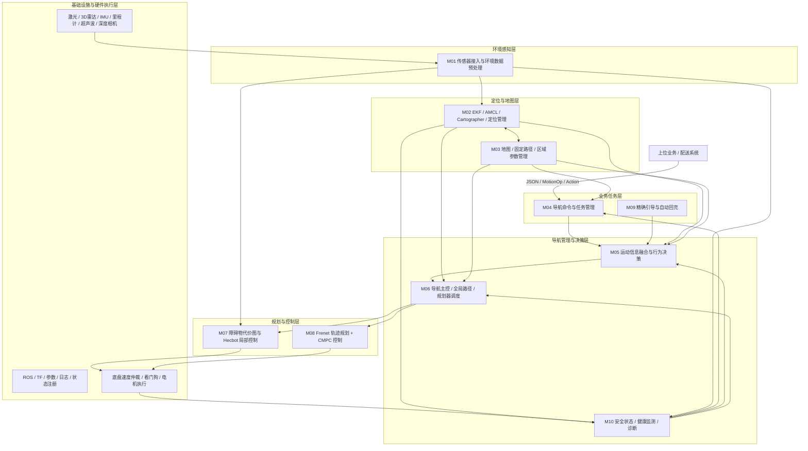
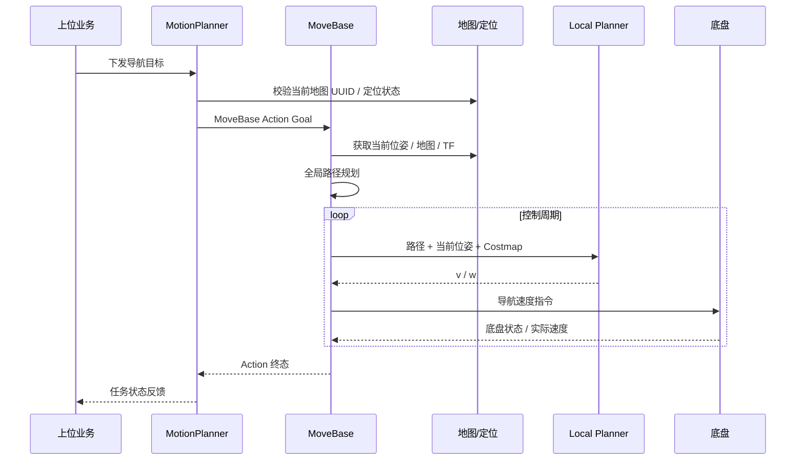
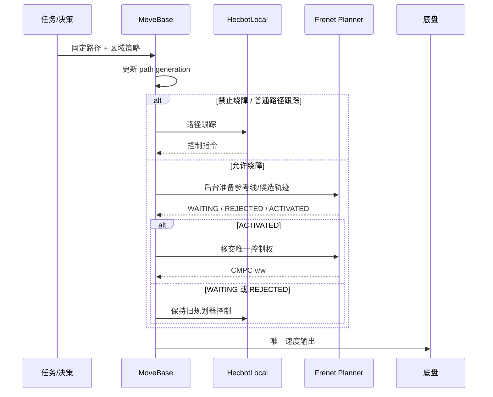
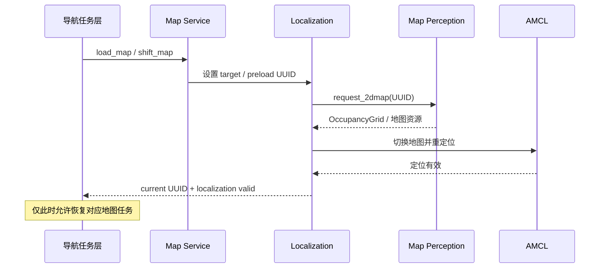
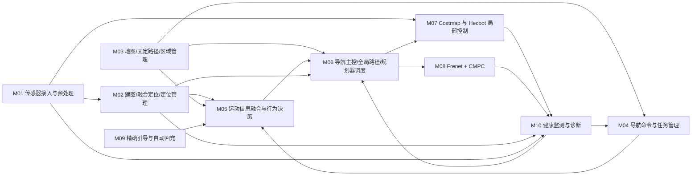
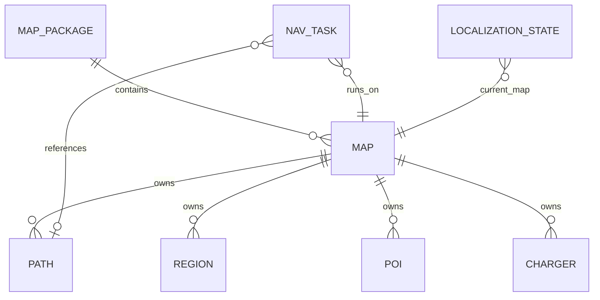

# HL7 导航侧算法概要设计文档

本文档针对 HL7 导航侧算法系统给出概要设计，重点回答：

- 系统如何分层与划分模块；
- 各模块之间如何交互、数据如何流转；
- 关键导航能力采用什么技术方案；
- 为什么采用当前架构，以及关键风险和约束是什么。

**适用读者**：导航算法、定位建图、感知、底盘、平台、测试负责人及 TR2 评审专家。  
**不覆盖内容**：函数级、类级、字段级、SQL 级及具体参数级实现设计，相关内容以《HL7导航侧算法详细设计及评审_A6(2)》为准。

---

## 1 项目基本信息

| 项目 | 内容 |
| --- | --- |
| 项目名称 | HL7 导航侧算法系统 |
| 文档版本 | V0.1 |
| 编写人 | 待填写 |
| 编写日期 | 待填写 |
| 对应 PRD | HL7 产品/导航需求，具体受控版本待冻结 |
| 对应系统规格说明书 | HL7 系统规格说明，具体受控版本待冻结 |
| 设计输入 | 《HL7导航侧算法详细设计及评审_A6(2)》 |
| 文档状态 | 草稿 / 待评审 |

---

## 2 设计目标与范围

### 2.1 设计原则与目标

**设计原则**：

- **分层解耦**：业务任务、导航决策、规划控制、定位地图、环境感知及硬件执行按职责分层，避免跨层耦合。
- **单一权威状态**：地图 UUID、定位状态、任务状态、规划器控制权和最终速度控制权均定义唯一权威来源，避免多链路状态冲突。
- **安全优先**：急停、底盘故障、定位失效和环境数据失效优先于任务执行和路径跟踪，异常情况下优先保持可解释的停止状态。
- **复用成熟能力**：基于 HL3 现有导航能力演进，包括 ROS、MoveBase、AMCL、Cartographer、robot_localization、HecbotLocal、Frenet、CMPC、地图服务和回充能力。
- **接口契约化**：ROS Topic / Service / Action、共享内存及外部协议均明确生产方、消费方、坐标系、单位、状态语义和异常处理。
- **可验证与可追溯**：关键状态迁移、地图切换、规划器切换、急停、定位异常、回充确认等过程均应形成可追溯日志及验证证据。

**设计目标**：

| 维度 | 内容 |
| --- | --- |
| 本期需求覆盖度 | 覆盖建图、定位、地图管理、导航任务、固定路径、局部规划、动态避障、精确引导、回充、安全监控等导航侧核心能力 |
| 关键非功能性指标 | 导航控制实时性、定位稳定性、地图一致性、任务可恢复性、控制权唯一性、异常停车安全性 |
| 关键扩展点 | 多传感器接入、地图格式升级、规划器插件扩展、区域策略扩展、不同充电桩及精确引导方式扩展 |
| 关键约束 | ROS 1 既有架构、HL3 现有代码资产、底盘最终执行接口、HL7 真实 BOM/TF/轮廓尚需冻结 |

### 2.2 设计范围

| 类型 | 内容 |
| --- | --- |
| 本期范围内 | 传感器数据消费与预处理；EKF 融合定位；AMCL 地图定位；Cartographer 建图管理；地图/固定路径/区域数据管理；导航任务管理；运动决策；全局与局部规划；Frenet 绕障；CMPC 跟踪；精确引导与自动回充；安全状态和健康监测 |
| 本期范围外 | 配送订单业务、货柜权限、门禁/梯控业务逻辑、多机调度上层策略、用户界面、电机驱动底层控制、电池容量与充电电气保护 |
| 后续开发 | HL7 专用硬件 BOM、TF、轮廓参数冻结；高速工况验证；定位精度专项验证；公共接口版本冻结；遗留地图接口逐步下线 |

### 2.3 软硬件分工

| 功能 | 负责方 | 说明 |
| --- | --- | --- |
| 传感器采集、驱动与底层故障 | 嵌入式 / 驱动层 | 输出激光、点云、IMU、里程计、超声波、底盘状态等原始数据 |
| 定位、建图、地图管理 | 导航算法侧 | 完成连续状态估计、地图定位、地图生命周期及地图数据发布 |
| 路径规划、避障和速度计算 | 导航算法侧 | 负责路径生成、局部轨迹规划、控制速度计算及规划器调度 |
| 最终速度仲裁、制动和电机执行 | 底盘 / 驱动层 | 对导航输出进行最终安全限制、看门狗保护及电机执行 |
| 配送任务与业务调度 | 上位业务系统 | 下发导航业务任务，消费任务执行状态 |
| 门禁、梯控、多机调度 | 外部系统 / 上位业务 | 与导航通过既定接口协同，不由导航算法直接承担业务策略 |
| 自动回充运动与对接 | 导航算法侧 + 底盘 | 导航负责规划、对接和状态机；底盘/电源负责真实充电状态和电气安全 |

---

## 3 系统架构

### 3.1 整体架构图

导航系统按“业务任务层—导航管理层—规划控制层—定位地图层—环境感知层—基础设施与硬件执行层”划分。

**分层职责说明**：

| 层级 | 主要职责 | 代表模块 |
| --- | --- | --- |
| 业务任务层 | 接收外部导航任务、任务互斥、任务编排、精确对接与回充 | M04、M09 |
| 导航管理与决策层 | 汇聚任务/机器人/地图信息，生成运动决策，调度规划器并管理安全状态 | M05、M06、M10 |
| 规划与控制层 | 局部障碍处理、路径跟踪、绕障轨迹生成、速度控制 | M07、M08 |
| 定位与地图层 | 连续状态估计、地图定位、建图模式、地图切换、路径和区域数据 | M02、M03 |
| 环境感知层 | 多传感器接入、过滤、融合预处理、障碍数据输出 | M01 |
| 基础设施与执行层 | ROS 通信、TF、参数、日志、底盘最终速度执行和硬件安全 | 基础设施 + 底盘 |

### 3.2 关键技术决策（ADR）

| 决策编号 | 决策主题 | 最终方案 | 关键理由 |
| --- | --- | --- | --- |
| ADR-001 | 定位与建图体系 | 采用 robot_localization EKF + AMCL + Cartographer 的分工架构 | EKF 提供连续局部状态，AMCL负责已知地图全局定位，Cartographer承担建图；职责清晰并复用现有成熟链路 |
| ADR-002 | 局部规划与固定路径绕障 | 保留 HecbotLocal 与 Frenet 双规划器，由 MoveBase 统一调度并采用两阶段接管 | HecbotLocal负责固定路径稳定跟踪和禁绕停车，Frenet用于需要绕障的区域；通过代次和原子接管避免双控制与旧结果复活 |
| ADR-003 | 地图数据与运行时身份 | 以 HL3 UUID 地图主链为权威，结构化数据统一由 map.db 与 map package 管理 | 解决旧 scene/map 名称和分散 SQLite 的一致性问题，并支持加载、预加载、电梯切图和地图全生命周期管理 |

### 3.3 关键动态流程

#### 3.3.1 普通到点导航流程

#### 3.3.2 固定路径与 Frenet 绕障交接流程

#### 3.3.3 地图加载与定位恢复流程

---

## 4 模块划分

### 4.1 模块全景图

### 4.2 基座模块清单

| 模块编号 | 模块名称 | 核心职责 | 优先级 |
| --- | --- | --- | --- |
| B-01 | ROS 通信与节点生命周期基础 | Topic / Service / Action 通信、节点启动、进程管理及重启 | P0 |
| B-02 | TF 与坐标系基础 | 管理 map、odom、base_link 及传感器外参关系 | P0 |
| B-03 | 配置与参数管理 | 管理导航、定位、感知、规划器、Costmap 及地图相关配置 | P0 |
| B-04 | 日志与事件追踪 | 记录任务、地图、规划器切换、安全事件、速度和错误原因 | P1 |
| B-05 | 状态注册与健康基础 | 节点心跳、机器人状态注册、健康 beacon 与故障汇总 | P0 |
| B-06 | 速度输出与底盘接口 | 导航速度输出、底盘仲裁、看门狗与最终电机执行边界 | P0 |

### 4.3 业务模块清单

| 模块编号 | 模块名称 | 核心职责 | 优先级 |
| --- | --- | --- | --- |
| M01 | 传感器接入与环境数据预处理 | 接入 2D 激光、3D 点云、深度/视觉、超声波等观测并提供定位及障碍输入 | P0 |
| M02 | 建图、融合定位与定位管理 | EKF 连续状态估计、AMCL 地图定位、Cartographer 建图及模式管理 | P0 |
| M03 | 地图、固定路径与区域参数管理 | 地图包、UUID、地图加载/保存、固定路径、POI 和区域行为数据管理 | P0 |
| M04 | 导航命令与任务管理 | 接收上位任务，管理任务互斥、暂停/恢复/取消和状态反馈 | P0 |
| M05 | 运动信息融合与行为决策 | 汇聚底盘、地图、路径及机器人信息，生成导航行为与阶段决策 | P0 |
| M06 | 导航主控、全局路径与规划器调度 | MoveBase 主控、全局规划、恢复机制、局部规划器选择与控制权管理 | P0 |
| M07 | 障碍物代价图与 Hecbot 局部控制 | 构建局部障碍环境、固定路径跟踪、预停车和禁止绕障策略 | P0 |
| M08 | Frenet 轨迹规划、CMPC 与两阶段交接 | 生成绕障候选轨迹、碰撞评价、MPC 跟踪并安全接管控制权 | P0 |
| M09 | 精确引导与自动回充 | 货位/停车位精确对接、充电桩检测、回充状态机和真实充电确认 | P1 |
| M10 | 安全状态、健康监测与诊断 | 汇总底盘、定位、传感器、节点及速度健康状态，决定停止/恢复条件 | P0 |

### 4.4 模块依赖关系

核心依赖遵循以下原则：

1. M04 不直接控制底盘，只通过 M05/M06 进入导航执行链；
2. M06 是规划器控制权的唯一调度中心；
3. M07 和 M08 不同时拥有最终控制权；
4. M03 提供地图和路径数据，但是否允许执行由 M02 的当前地图 UUID 与定位有效状态共同确认；
5. M10 可阻断任务和运动恢复，但健康恢复不等于自动恢复运动；
6. 最终速度安全仍由底盘侧仲裁和看门狗兜底。

---

## 5 数据与接口骨架

### 5.1 核心数据模型

导航系统不采用传统业务 ER 为主，而采用“地图实体 + 运行时状态 + 任务实体”的数据模型。

实体职责：

- **MAP_PACKAGE**：地图包资源集合，以 package UUID 标识；
- **MAP**：单张运行地图，以 map UUID 标识；
- **PATH**：固定路径及有序路径点；
- **REGION**：区域行为、速度、绕障、倒车等策略；
- **POI**：业务导航点；
- **CHARGER**：充电桩及其地图关系；
- **NAV_TASK**：当前导航任务及其执行上下文；
- **LOCALIZATION_STATE**：target/current/preload 地图 UUID 与定位状态。

### 5.2 数据存储方案

| 数据类型 | 存储选型 | 选型理由 |
| --- | --- | --- |
| 地图结构化数据 | SQLite `~/.ros/map.db` | 统一管理地图、路径、区域、POI、充电桩等结构化对象，便于 UUID 化和事务式查询 |
| 地图文件 | `~/.ros/map_packages/<package_uuid>/<map_uuid>/` | 保存 PGM/PNG/YAML/PCD 等地图资源，与 map UUID 一一关联 |
| 定位/导航运行状态 | ROS Topic / Service / Action + 内存状态 | 强实时、事件驱动，适合导航执行链 |
| 任务与规划器上下文 | 进程内状态 + generation/token | 用于避免旧任务、旧规划结果和异步结果重新激活 |
| 日志与验证数据 | ROS 日志 / bag / 事件记录 | 支持故障回溯、评审和验收 |

### 5.3 对外接口清单

| 接口编号 | 接口名称 | 调用方 | 接口类型 | 数据格式 | 对应模块 | 主导方 |
| --- | --- | --- | --- | --- | --- | --- |
| API-001 | 上位导航命令与反馈 | 上位业务 | Topic / Service | JSON / JString | M04 | 双方 |
| API-002 | 普通到点导航 | M04 | Action | MoveBase Action | M06 | 本侧 |
| API-003 | 暂停与恢复 | 上位 / M04 | Service | ROS Srv | M04/M06 | 本侧 |
| API-004 | 固定路径任务 | 上位 / M04 | Service | MotionOp Srv | M04/M05 | 本侧 |
| API-005 | 多段行驶任务 | 上位 | Service | ROS Srv | M04 | 本侧 |
| API-006 | 固定路径查询 | M04/M05/M06 | Service | PathQuery | M03 | 本侧 |
| API-007 | 地图栅格与地图对象 | M02/M06 | Topic / Service | OccupancyGrid / ROS Msg | M03 | 本侧 |
| API-008 | 当前位姿 | M04/M05/M06 | Topic / TF | Odometry / TF | M02 | 本侧 |
| API-009 | 超声波量程与模式 | 导航 / 驱动 | Topic / Service | ROS Msg/Srv | M01 | 双方 |
| API-010 | 底盘状态 | 底盘 | Topic | 状态数组/消息 | M05/M10 | 底盘侧 |
| API-011 | 速度输出 | M06/M07/M08 | Shared Memory / Topic | TwistStamped | B-06 | 双方 |
| API-012 | 执行状态与导航状态 | 导航 / 上位 | Topic | ROS Msg / JSON | M04/M10 | 本侧 |
| API-013 | 地图操作 | 上位 / 导航 | Service | ROS Srv | M03 | 本侧 |
| API-014 | 回充感知命令与目标 | M09 | Service / Topic | ChargeDetection / ChargerIntegrateInfo | M09 | 本侧 |
| API-015 | 定位状态与地图切换状态 | M03/M04 | Topic / Service | UUID + status | M02 | 本侧 |
| API-016 | 参数与 Costmap 维护 | 运维 / 导航 | Service / Parameter | ROS Srv / Param | M06/M07 | 本侧 |

**接口约束**：

- 地图身份统一使用 map package UUID / map UUID；
- 地图业务加载成功不等于定位恢复成功；
- Service 返回“受理成功”不等于任务执行完成；
- 任务完成以 Action/导航状态终态为准；
- 最终速度控制权必须唯一；
- Topic 存在不代表数据有效，必须校验时间戳、数据龄期和健康状态；
- 公共消息定义、MD5、坐标系、单位及超时策略需随版本冻结。

---

## 6 技术方案选型

### 6.1 多传感器接入与环境建模

采用 ROS 标准消息和既有感知中心接入 2D 激光、3D 点云、深度视觉、超声波等传感器。感知层负责设备数据过滤、自遮挡剔除及环境观测整理，向定位与 Costmap 提供统一输入。

**选型理由**：复用现有驱动和消息生态；不同传感器职责解耦；便于根据 HL7 最终 BOM 做裁剪。

### 6.2 EKF 连续状态估计

采用 robot_localization EKF 融合轮式里程计、IMU 及配置启用的运动观测，输出连续 odom 状态及协方差。

**选型理由**：轮式机器人短时运动连续性强；EKF 可为局部控制提供高频、平滑的运动状态，同时保持与全局地图定位解耦。

### 6.3 AMCL 地图定位

已知地图运行采用 AMCL，将 LaserScan 与 OccupancyGrid 匹配生成 map→odom 和全局位姿。

**选型理由**：2D 室内物流机器人应用成熟，能够直接复用已有栅格地图和激光雷达；与 EKF 的 odom 连续估计形成典型 map/odom/base_link 分层。

### 6.4 Cartographer 建图

建图模式使用 Cartographer 及其轨迹管理服务，由定位管理模块负责模式切换、轨迹启停和地图保存流程。

**选型理由**：复用既有建图资产；与运行时 AMCL 定位解耦，避免将建图算法直接侵入导航任务执行链。

### 6.5 MoveBase 导航主控

MoveBase 作为导航执行和规划器调度中心，负责普通到点 Action、全局路径、Costmap 生命周期、控制循环和恢复机制。

**选型理由**：现有 ROS1 导航栈已深度集成；可作为任务层、地图层和多种局部规划器之间的统一执行入口。

### 6.6 HecbotLocal + Frenet 双局部规划

- **HecbotLocal**：负责固定路径稳定跟踪、预停车、禁绕和基础局部控制；
- **Frenet**：负责允许绕障区域中的候选轨迹生成与碰撞评价。

两者由 MoveBase 根据区域策略、路径属性和 collision_avoidance 状态动态选择。

**选型理由**：医院物流场景既存在严格路线约束区，也存在允许局部绕障区，单一规划器难以同时满足“严格沿线”和“动态绕行”。

### 6.7 CMPC 轨迹跟踪

Frenet 轨迹由 CMPCController 跟踪，根据局部误差模型计算线速度和角速度。

**选型理由**：相比简单几何控制，更适合在轨迹曲率、速度连续性和控制约束同时存在的情况下实现平滑跟踪。

### 6.8 两阶段规划器交接

Frenet 采用“后台准备 + 原子激活”两阶段机制，并通过 generation/token 控制异步结果生命周期。

**选型理由**：避免参考线构建阻塞当前控制；避免旧异步规划结果晚到后重新获得控制权；确保任一时刻只有一个局部规划器输出有效速度。

### 6.9 UUID 地图主链

运行时地图以 map package UUID + map UUID 唯一标识，结构化地图对象存入 map.db，地图文件保存在 map package 目录。

**选型理由**：解决旧 scene_name/map_name、多数据库、多目录链路之间的一致性问题；适合地图加载、预加载、电梯切图和版本管理。

### 6.10 精确引导与自动回充

自动回充采用任务编排层 + 桩型状态机 + 充电桩感知的分层设计。感知可按配置选择 2D 激光、iToF 或 Livox；最终成功以真实充电状态为准。

**选型理由**：不同桩型和传感器差异较大，通过状态机与检测器插件化可以隔离硬件差异，同时保持上层任务接口一致。

---

## 7 风险与约束

### 7.1 已识别风险

| 风险编号 | 风险描述 | 影响等级 | 应对措施 |
| --- | --- | --- | --- |
| R-001 | HL7 专用轮廓、base_link 定义及传感器外参尚未完全冻结 | 高 | 以实机 CAD/BOM/标定结果冻结 footprint、TF 和安全裕量 |
| R-002 | 产品最高速度与当前导航配置存在较大差异，高速制动能力未充分验证 | 高 | 逐级提升速度，完成满载/不同地面/坡面制动和探测距离联合验证 |
| R-003 | 最终速度共享内存、底盘仲裁和看门狗链路尚未形成完整软件闭环证据 | 高 | 冻结唯一控制权和超时协议，开展故障注入停车验证 |
| R-004 | 部分公共 ROS 消息、JString、MD5 及外部依赖定义尚未完全冻结 | 中 | 建立接口版本清单，联调前冻结消息定义、MD5、单位、坐标系及错误语义 |
| R-005 | 地图旧链路与 UUID 新链路并存可能导致状态误判 | 高 | 以 UUID 主链为唯一权威，旧接口仅保留兼容且不得改变权威状态 |
| R-006 | Frenet 异步准备可能产生取消/复位/换路竞态 | 高 | generation/token 管理结果生命周期，两阶段原子接管，覆盖竞态专项测试 |
| R-007 | AMCL 在重复走廊、玻璃和地图变化环境中可能退化 | 中 | 引入定位健康判定、重定位机制及专项真值测试 |
| R-008 | 多种充电桩和检测器尚未冻结 HL7 实际选型 | 中 | 根据真实硬件选定桩型与检测器，并完成误检、丢失、急停和异常退出验证 |

### 7.2 技术约束

- 当前主系统架构基于 ROS 1 / catkin 既有工程，正式部署版本需单独冻结。
- 导航最终输出为差速底盘线速度和角速度，不把 `linear.y` 视为横移能力。
- 所有运动任务必须在当前地图 UUID 一致且定位有效时执行。
- 底盘急停、通信故障、定位失效和关键环境数据失效具有高于任务执行的安全优先级。
- 任何规划器切换均必须保证控制权唯一，不允许 HecbotLocal 与 Frenet 同时有效输出。
- 地图加载 Service 成功不能替代定位有效判据。
- 真实 footprint、传感器盲区、探测距离和制动距离必须通过 HL7 实机验证，不允许直接沿用旧机型参数。
- 地图、定位、任务、规划器、速度输出和故障状态必须具备统一日志与时间线，支持问题回溯。

---

## 8 概要设计结论

HL7 导航侧沿用并重构现有 HL3 导航能力，整体架构以 **任务编排、导航决策、规划控制、定位地图、环境感知、安全监控** 六类职责为核心，通过 ROS 接口及底盘执行边界形成闭环。

架构设计的核心原则是：

1. **任务层不直接控制底盘**；
2. **MoveBase 统一管理导航执行和规划器控制权**；
3. **HecbotLocal 与 Frenet 按区域策略协同，但控制权唯一**；
4. **EKF 提供局部连续状态，AMCL 提供全局地图定位，Cartographer 负责建图**；
5. **UUID 地图主链是运行时地图身份的唯一权威**；
6. **任何任务恢复均以地图、定位、底盘和安全状态重新有效为前提**；
7. **导航计算速度与底盘最终执行之间保持独立安全仲裁和看门狗边界**。

本概要设计用于明确 HL7 导航系统的整体架构与模块边界。具体类、函数、参数、状态机细节、数据库字段、接口字段及算法公式继续以详细设计文档为准。
