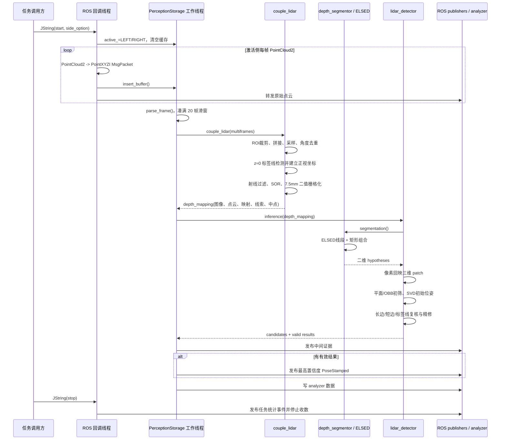

# perception_storage：3D 激光雷达点云检测全流程

本文基于 `perception_storage` 功能包当前代码的实际调用关系整理，只描述由
`perception_storage.cpp` 驱动的 3D 激光雷达货柜/货架检测主链。ToF 检测、碰撞监控和
点云位姿跟踪仅在“范围边界”中说明，不混入检测流程。

## 1. 结论概览

默认配置 `SettingPara/sensor_type: lidar` 下，程序的检测链为：

```text
run.launch
  -> perception_storage_node（perception_node.cpp）
  -> PerceptionStorage 初始化
  -> 等待 /hecbot_perception/storage_detect 的 start 请求
  -> 只接收请求指定一侧的 Livox 点云
  -> 20 帧滑动窗口融合
  -> 三维 ROI 裁剪、采样、角度去重
  -> 从 z≈0 的薄层中寻找 0.21 m 辅助板/标签线，建立正视坐标
  -> 对货架底部点云做射线近点保留和离群点滤波
  -> 以 7.5 mm/像素栅格化为二维二值图，同时保留像素到三维点的索引
  -> ELSED 线段检测并组合出矩形候选
  -> 候选像素区域映射回三维点云
  -> 平面、尺寸、长边框、远端导向结构等几何约束复核
  -> 精修目标朝向和位置，按置信度选择最优结果
  -> 发布 PoseStamped、调试点云/图像和任务统计
```

它本质上是“3D 点云构造 2D 占据投影以产生候选，再回到 3D 做几何验证和位姿求解”，
不是神经网络检测。

## 2. 代码范围与实际入口

### 2.1 启动入口

- `launch/run.launch` 只启动 `perception_storage_node`，并加载 `config/config.yaml` 到节点私有命名空间。
- `src/perception_node.cpp` 创建：
  - `PerceptionStorage`：本文的检测主链；
  - `pose_tracker::pose_tracker`：独立的后续跟踪器；
  - 然后进入单线程 `ros::spin()`。
- `PerceptionStorage` 构造函数另外创建一个检测工作线程执行 `running()`，所以 ROS 回调负责收数，工作线程负责批处理和检测。
- `CMakeLists.txt` 将 `perception_storage.cpp`、`lidar_detector.cpp`、`points_filter.cpp`、
  `tool_box.cpp`、`analyzer.cpp` 和深度线段模块链接到 `perception_storage_node`。

### 2.2 本流程直接涉及的文件

| 文件 | 职责 |
|---|---|
| `src/perception_node.cpp` | 节点入口 |
| `src/perception_storage.cpp` | 参数读取、任务控制、点云缓存、多帧融合、二维投影、发布 |
| `include/perception_storage/perception_storage.hpp` | 主类、队列、线程、ROS 接口定义 |
| `include/perception_storage/common.hpp` | 配置、消息包、二维/三维映射、候选和位姿数据结构 |
| `src/lidar_detector.cpp` | 二维候选回映三维后的检测、几何验证和位姿精修 |
| `src/points_filter.cpp` | 均匀采样、RANSAC 平面/直线、SVD 法向估计 |
| `src/depth_runner/depth_segmentor.cpp` | ELSED 线段筛选和矩形候选组合 |
| `src/depth_runner/depth_elsed.cpp` | 图像梯度、锚点、线段提取和方向一致性验证 |
| `src/depth_runner/depth_edgedrawer.cpp` | 沿梯度连接边缘、线段拟合与延伸 |
| `src/depth_runner/depth_fullsegment.cpp` | 线段最小二乘拟合和端点维护 |
| `src/tool_box.cpp` | 候选框组合、TF 读取、位姿矩阵和点到线距离工具 |
| `src/analyzer.cpp` | 可选的每次推理数据落盘和任务统计 |

### 2.3 明确排除的支路

- `tof_detector.cpp`、`couple_tof()` 和 ToF 同步回调：仅在 `sensor_type: tof` 时使用。
- `hecbot_storage_itof_monitor.cpp`：属于另一个可执行程序 `monitor`，`run.launch` 不启动它。
- `pose_tracker/` 与 `nano_gicp/`：节点启动时会同时创建跟踪器，但它由
  `/hecbot_perception/storage_goal_pose` 单独激活；它不向 `PerceptionStorage` 提供检测候选或修正检测结果。
  两者唯一直接联系是跟踪器状态经 `/perception/storage/tracker/tracker_state` 被包装成事件发布。
- `repub_node.cpp` 没有加入当前 `CMakeLists.txt` 的任何目标；`space_checks.cpp` 为空实现。

## 3. 默认配置、输入和输出

### 3.1 与雷达检测直接相关的默认参数

| 配置 | 默认值 | 实际用途 |
|---|---:|---|
| `LidarSensors/points_left` | `/livox/lidar_rear` | `side_option=left` 时的数据源 |
| `LidarSensors/points_right` | `/livox/lidar_front` | `side_option=right` 时的数据源 |
| `LidarSensors/range_compenstion` | `0.05 m` | 最终位置沿目标 x 方向的距离补偿 |
| `SettingPara/sensor_type` | `lidar` | 选择雷达订阅、`couple_lidar()` 和 `lidar_detector` |
| `SettingPara/batch_size` | `[1, 20]` | 雷达使用第二项，即 20 帧 |
| `SettingPara/trouble_shoting` | `true` | 开启 `analyzers/` 调试数据记录 |
| `SettingPara/stop_criteria` | `250` | 代码定义了自停阈值，但当前主循环未调用 `stop_self()` |
| `TargetInfo/lower_layer/length` | `1.07 m` | ROI、候选位置和长边范围 |
| `TargetInfo/lower_layer/width` | `0.594 m` | ROI、边框间距和射线过滤 |
| `TargetInfo/lower_layer/height` | `0.43 m` | ROI 高度 |
| `TargetInfo/supplementary/paras[0]` | `0.21 m` | 辅助板/标签线宽度，也是二维候选的尺度基准 |
| `FrameNames/rear_frame` | `livox_frame_rear` | left 对应的静态 TF 源坐标系 |
| `FrameNames/front_frame` | `livox_frame_front` | right 对应的静态 TF 源坐标系 |

`LidarSensors/width`、`height`、`flip` 在当前雷达检测主链中只被读入配置对象，没有参与后续计算。
`SettingPara/reference_pose` 被读入但未使用；服务请求中的 `reference_pose` 也只被保存，没有参与检测。
配置中的 `reference_ground` 没有被 `read_params()` 读取。

### 3.2 任务控制服务

服务名：`/hecbot_perception/storage_detect`，类型为 `hecbot_srvs/JString`，请求体是 JSON 字符串。

启动示意：

```json
{
  "detect_op": "start",
  "side_option": "left",
  "cabinet_model": "...",
  "reference_pose": {"x": 0.0, "y": 0.0, "th": 0.0}
}
```

- `detect_op=start` 时，只有 `side_option` 为 `left` 或 `right` 才会激活检测。
- `cabinet_model` 仅打印日志，没有影响模型尺寸或算法分支。
- `start()` 清空两级缓存和历史结果，选择一侧传感器，并令 `active_` 进入 LEFT/RIGHT。
- `detect_op=stop` 时调用 `stop()`：停止收数、清空缓存、发布本次任务成功/失败事件并写统计。
- 当前 `running()` 不调用 `stop_self()`，所以即使推理次数超过 250，也不会自动停止；正常结束依赖外部 `stop` 请求。

### 3.3 主要输出

| 话题 | 内容 |
|---|---|
| `/hecbot_perception/storage_result` | 当前批次置信度最高的 `geometry_msgs/PoseStamped` |
| `/hecbot_perception/storage/naive_region` | 三维裁剪 ROI 的线框 MarkerArray |
| `/hecbot_perception/storage/depth_detect` | 二维投影上的候选可视化图 |
| `/hecbot_perception/storage/proposal_points` | 通过二维候选回映得到、且进入几何检查的分组点云 |
| `/hecbot_perception/storage/proposal_pose` | 通过平面与尺寸初筛的候选位姿 |
| `/hecbot_perception/storage/evidence_points` | 最终有效目标使用的标签线/长边/可选短边证据点 |
| `/hecbot_perception/storage/evidence_pose` | 当前批次全部有效位姿 |
| `/perception/debug/poses` | 当前任务累计的已发布位姿 |
| `/perception/source/points` | 激活侧收到的原始点云转发 |
| `/perception/capture/points` | z≈0 参考特征与射线过滤结果的调试点云 |
| `/hecbot_perception/storage_detect_info` | 检测/跟踪事件 JSON |

`/hecbot_perception/storage/base_points` 虽然创建了 publisher，但当前代码没有发布它。

## 4. 初始化流程

`PerceptionStorage::init()` 的实际顺序如下：

1. `read_params()` 读取雷达、ToF、目标尺寸、运行参数、发布话题和坐标系名称。
2. 因默认传感器类型为 LIDAR，阻塞等待以下静态 TF：
   - `base_link <- livox_frame_front`，保存到 `matrix_right`；
   - `base_link <- livox_frame_rear`，保存到 `matrix_left`。
3. 将检测状态设为 `SLEEPY`。
4. `set_processor()` 订阅前后两路 Livox 点云，队列长度均为 2。
5. `set_publishers()` 创建结果和调试话题。
6. 初始化消息队列、计数器、`points_filter` 和 `analyzer`。
7. 构造函数启动 `running()` 工作线程。
8. 因传感器类型为 LIDAR，实例化 `lidar_detector`：
   - 二维栅格分辨率固定为 `0.0075 m/pixel`；
   - 目标线长度阈值为 `floor(0.21 / 0.0075) = 28 pixel`；
   - 线段方向阈值为 45°；
   - `loosely=false`；
   - 远端导向结构间距 `free_distance=0.495 m`；
   - 同时生成与第一轮硬裁剪一致的 ROI 线框。

注意：初始化时读取的 `matrix_left/right` 没有用于把送入检测器的点云变换到 `base_link`；
它们只在结果记录阶段计算分析器中的 base_link 数值。检测和发布的位姿均沿用激活雷达点云的坐标系及 header。

## 5. 收数、缓存和 20 帧滑窗

### 5.1 回调门控

`process_lidar(points, which_side)` 只在回调侧与 `active_` 相同的情况下处理：

1. ROS `PointCloud2` 转为 `pcl::PointCloud<pcl::PointXYZI>`；
2. 保存原消息 header；
3. 包装成 `MsgPacket`，left 标记为 1/LEFT，right 标记为 2/RIGHT；
4. 在互斥锁保护下压入 `msg_packet`；
5. 同时原样发布到 `/perception/source/points`。

未激活或另一侧的点云直接忽略。

### 5.2 两级队列与窗口行为

- `msg_packet` 是回调写入的临时队列。
- `parse_data()` 在锁内把它整体搬到局部队列并清空。
- `parse_frame()` 再次核对消息的 side，只把激活侧加入 `process_queue`。
- 当 `process_queue.size() >= 20` 时，将当前队列全部交给一次推理，然后持续弹出队首，直到剩余少于 20 帧。

因此在正常逐帧到达时：第一次推理使用第 1～20 帧；完成后保留第 2～20 帧；下一帧到达后使用第 2～21 帧。
这是“窗口 20、步长 1、重叠 19 帧”的滑动融合，而不是每 20 帧互不重叠地处理一次。

工作线程每轮末尾固定休眠 50 ms。如果一次取队列时积累超过 20 帧，该批次可能包含超过 20 帧，随后仍只保留最后 19 帧。

## 6. `couple_lidar()`：多帧三维预处理与二维投影

### 6.1 多帧拼接和硬 ROI

每帧先在原始雷达坐标系按顺序做 PassThrough：

```text
y ∈ [-2.5 × lower_width, -0.1] = [-1.485, -0.1] m
x ∈ [-1.2 × lower_length, 0.2 × lower_length] = [-1.284, 0.214] m
z ∈ [-lower_height, 1.2 × lower_height] = [-0.43, 0.516] m
```

裁剪后的所有帧直接拼接。这里没有依据每帧时间戳做运动补偿，也没有通过 TF 先变换到
`base_link`，所以窗口内机器人或传感器运动会直接表现为点云重影。

拼接后执行：

1. `UniformSampling`，搜索半径 `0.0025 m`；
2. 用球面方向 `(phi, theta)` 分桶，角分辨率 `0.00175 rad`（约 0.1003°）；
3. 同一方向桶只保留到雷达原点欧氏距离更近的点。

### 6.2 在 z≈0 薄层中寻找辅助板/标签线

从融合点云截取 `z ∈ [-0.025, 0.025] m`，将 z 置零，再做以下处理：

1. 按 `atan2(x, y)` 以 0.25° 分桶；每桶保留最近点，如果次近点与最近点距离差小于 1 cm，也保留次近点。
2. 按 x 以 5 mm 分桶；每桶保留 `|y|` 最小的点。
3. 按 `atan2(x, |y|)` 排序，形成沿扫描方向有序的二维轮廓。
4. 欧氏聚类：容差 2.5 cm，点数 5～450。
5. 聚类首尾距离必须接近辅助特征宽度 `0.21 m`，允许误差为其 50%，即约 0.105～0.315 m。
6. 对聚类做 RANSAC 直线拟合：距离阈值 1 cm，最多 100 次；要求至少 10 个内点且内点率至少 80%。
7. 在该聚类前后搜索结构关系：
   - `with_line`：距离拟合线小于 2 cm 的共线延伸点；
   - `width_diagonal`：距拟合线约 `0.5 × lower_width = 0.297 m`，且纵向位置符合货架长度关系的点。
8. 只有 `width_diagonal` 非空且 `with_line < 5` 才继续。
9. 标签中点还必须满足：
   - `|mid_x + 0.5 × lower_length| < 0.4 × lower_length`；
   - `0.5 × lower_width < |mid_y| < 2 × lower_width`；
   - 标签线方向与雷达 x 轴夹角小于 30°。

满足这些条件的拟合线成为 `proposal_coef`，中点成为 `proposal_mid`。

### 6.3 建立正视坐标

只有恰好找到 1 个标签候选时，`reference_init=true`：

- 新坐标 y 轴取标签线方向，并强制其 x 分量为正；
- 新坐标 z 轴固定为 `(0,0,1)`；
- 新坐标 x 轴为 `y × z`；
- 原点为标签线中点；
- 组装矩阵后取逆，得到把雷达点变到标签正视坐标的 `T_lidar_matrix`。

若不是恰好 1 个候选，则使用兜底矩阵：绕 z 轴旋转 +90°，平移
`0.5 × lower_length`。兜底分支没有取逆。

所有融合点经 `T_lidar_matrix` 变换。若参考标签唯一，还额外裁剪：

```text
y ∈ [-0.5 × lower_length - 0.1, 0.5 × lower_length + 0.1]
x ∈ [-0.5 × lower_width - 0.1, 0.5 × lower_width - 0.1]
```

随后再次以 0.00175 rad 的球面角分桶，每桶保留近点。

### 6.4 货架底部射线过滤

1. 只取正视坐标中 `z ∈ [-0.2, 0.2] m` 的点。
2. 按 y 以 1 cm 分桶。
3. 对每个 y 桶计算 `|x|` 的最小值和最大值：
   - 若跨度大于 `lower_width`，保留 `|x| <= max - 0.1`；
   - 否则保留 `|x| <= min + 0.6 × lower_width`。
4. 对结果做 StatisticalOutlierRemoval：`MeanK=20`，`StddevMulThresh=1`。

这一步的作用是沿观察射线优先保留靠近雷达的一段结构，削弱货架后方或同方向更远的点。

### 6.5 构造二值投影和像素—点云映射

- 图像横轴对应正视坐标 y，范围取过滤点的 `[min_y, max_y]`；
- 图像纵轴对应固定 z 范围 `[-0.2, 0.2] m`；
- 栅格分辨率固定为 `0.0075 m/pixel`；
- 有点的像素赋值 255；
- `mapping_table[pixel]` 保存落入该像素的点索引，同一像素保留欧氏距离更近的点；
- 对空像素搜索约 ±1、±2 像素邻域，有至少两个非零邻居时补成非零，最后再次二值化。

点云随后用 `T_lidar_matrix^-1` 变回原雷达坐标。返回的 `depth_mapping` 包含：

- `depth`：二维二值投影；
- `points`：与映射表对应、已变回原雷达坐标的点；
- `mapping`：像素到 `points` 的索引；
- `cues_points`：上述点云的拷贝，供后续边框线索搜索；
- `mid_pixel`：若找到了唯一标签参考，其标签中点在投影图中的像素位置。

同时 `/perception/capture/points` 发布 z≈0 轮廓、参考标记和射线过滤点，header 使用窗口最后一帧。

## 7. `depth_segmentor`：二维线段和矩形候选

### 7.1 ELSED 线段提取

`depth_segmentor::segmentation()` 把二值图传给内置 ELSED：

1. 5×5、sigma=1 的高斯滤波；
2. Sobel x/y 梯度；梯度和阈值为 30；
3. 每 2 像素扫描锚点，初始锚点阈值 8；找不到时逐步减半；
4. `EdgeDrawer` 从锚点沿梯度方向双向跟踪边缘；
5. 以最小 15 像素、线拟合误差 0.2、点到线距离 1.5 像素形成和延伸线段；
6. 对线段像素的局部梯度方向做一致性验证，默认阈值 0.15 rad，方向内点多于外点才保留。

### 7.2 线段筛选

目标尺度 `length_threshold=28 pixel`。每条线段首先要求：

```text
|线长 - 28| < 0.75 × 28
```

即约 7～49 像素。然后按代码中的角度定义分类：

- `angle < 45°`：垂直边；
- `angle > 60°`：水平边。

默认 `loosely=false`，所以“1 条垂直边 + 1 条水平边”的宽松补框分支不会执行。

### 7.3 矩形候选组合

任意两条垂直边通过 `tool_box::max_box()` 延长到共同上下边界，形成四点框。框需满足：

- 上、下边长度不超过 `1.414 × 28 × 1.25`；
- 对角/宽度相关距离处于 `0.5 × 28` 到 `1.25 × 28`；
- 多组边长比均处于 0.5～2.0。

如果没有两边候选，但存在至少一条垂直边且 `mid_pixel` 有效，代码会尝试用参考标签中点镜像补出另一条边。
这条补框路径不受 `loosely=false` 限制。

每个四点框被逐行展开成左右像素边界，形成 `hypothesis.edge_points`，用于下一步回映三维点。

## 8. `lidar_detector`：候选回映、三维验证和位姿精修

### 8.1 二维候选回映三维

`lidar_detector::inference()` 每次先清空上一批的中间结果、候选和最终结果，并更新 ROI Marker。

对每个二维候选框：

1. 逐行遍历左右边界间的所有像素；
2. 通过 `mapping_table` 找对应三维点；
3. 将有效点组成一个候选 patch；
4. patch 非空时加入 `interm_result.second`，并在可视化图上标记边界。

当前判断是 `mapping_vt[i] > 0`，所以映射到点云索引 0 的像素会被忽略。

### 8.2 平面和尺寸初筛 `geomery_filter()`

对每个 patch：

1. RANSAC 平面拟合，点到平面阈值 1.5 cm；
2. 只保留平面内点；
3. 计算三维 OBB；
4. OBB 的 `max(box_width, box_height)` 必须位于：

```text
[0.7 × 0.21, 1.414 × 0.21] ≈ [0.147, 0.297] m
```

通过后，用平面点的 SVD 最小奇异向量作为法向，点均值作为中心。若法向 y 分量为负则翻转。
以该法向、全局 z 轴构造初始正交姿态，生成 `detect_targets` 中的候选位姿。

### 8.3 从完整线索点云中搜索货架边框

`refine_filter()` 使用候选 patch 和 `cues_points`：

1. 将标签 patch 变到候选目标坐标系，去除靠近货架底部、噪声较大的上半部分，只保留
   `z ∈ [tag_min_z, 0.5 × tag_max_z]`，再变回雷达坐标系。
2. 将全部 `cues_points` 变到候选目标坐标系，并提取：
   - 长边框：`x ∈ [0.5×lower_width-0.05, 0.5×lower_width+0.05]`，
     `y ∈ [-0.3×lower_length, 0.3×lower_length]`；
   - 远端导向结构：`y ∈ [0.5×0.495-0.02, 0.5×0.495+0.02]`，
     `x ∈ [-0.25×lower_width, 0.75×lower_width]`。
3. 将两组点变回雷达坐标系。
4. 对长边框按方位角 0.2° 分桶，每桶保留最靠近雷达的一小段点；至少需要 3 个点。
5. 对远端导向结构先做 1.5 cm RANSAC 平面拟合，再按 0.03° 分桶并保留近点；多于 3 个点时启用短边约束。
6. 将长边、短边和标签点都投影到雷达坐标系的 XOY 平面。
7. 分别做 RANSAC 直线拟合，距离阈值 7.5 mm；长边线至少需要 3 个内点。

长边存在时支持位标志至少为 2，能够进入最终精修；短边是加分和位置修正线索，不是必需条件。

### 8.4 最终几何约束与置信度

`finetuning_filter()` 依次检查：

1. 标签拟合线最大端点距离与 0.21 m 的差必须不超过 3 cm。
2. 标签线与长边线夹角小于 5°：置信度 +2。
3. 标签点到长边线的平均距离与 `0.5 × lower_width = 0.297 m` 的差小于 5 cm：
   置信度 +2，并认定 `large_condition=true`。
4. 如果短边有效：
   - 短边与长边夹角距 90° 小于 5°：置信度 +1；
   - 标签点到短边的平均距离与 `0.5 × free_distance = 0.2475 m` 的差小于 5 cm：置信度 +1。
5. 总置信度必须至少为 3。实际上长边的两个条件同时成立时通常得到 4；短边完整成立时得到 6。

### 8.5 位姿精修

长边条件成立后：

- 目标 y 轴设为长边方向的反向；
- 目标 z 轴设为 `(0,0,1)`；
- 目标 x 轴为 `y × z`，再重算 z 轴以正交化；
- 由该旋转矩阵取 ZYX 欧拉角，代码要求其 yaw 绝对值不小于 60°，否则拒绝；
- 初始位置为标签线质心，再沿目标 x 轴减去 `0.05 m` 的雷达距离补偿。

若短边也有效，计算长短边交点在长边方向上的投影。实际间距与 0.2475 m 的差不超过 1 cm 时，
沿目标 y 轴修正该误差的 75%，再应用 0.05 m 的 x 向距离补偿。

最终 `mpose` 包含：

- 精修后的 4×4 变换；
- 由变换生成的 `geometry_msgs/Pose`；
- 标签线、长边线以及可选短边线组成的证据点云；
- 置信度 4 或 6。

## 9. 后处理、结果选择和任务结束

每次 `detect_machine->inference()` 结束后，`post_process()`：

1. 取回二维可视化和三维 patch；
2. 取回通过平面/尺寸初筛的候选位姿；
3. 取回通过全部几何复核的最终位姿；
4. 累计本任务是否出现过候选、是否出现过有效结果；
5. 发布调试证据；
6. 若最终结果非空，选 `confident_index` 最大者发布。

最终 `/hecbot_perception/storage_result`：

- header 直接使用该窗口最后一帧点云的 header；
- pose 数值是检测所在的原始激活雷达坐标系结果；
- `matrix_base × target_pose.transform` 只用于 analyzer 记录 yaw/x/y，不会写回发布结果。

`stop()` 根据整个任务周期的累计量发布事件：

- 有任意有效结果：`storage_detection_success#<sensor>_<side>`；
- 从未推理：追加 `no_sensor_message`；
- 推理过但从未产生候选：追加 `no_hypothesis_target`；
- 有候选但从未有最终结果：追加 `no_valid_target`。

当 `trouble_shoting=true` 时，每次推理会在包内 `analyzers/<时间>/jobs/<序号>/` 记录源投影、源点云、
结果图和最佳结果点云，并记录耗时与位姿统计。任务结束时，如果任务曾产生有效结果，当前实验目录会被删除；
失败任务的现场数据则保留。

## 10. 完整时序



## 11. 阅读代码时需要特别注意的实际行为

以下不是流程设计推测，而是当前实现会直接表现出的行为：

1. **检测坐标系未统一到 `base_link`**：静态 TF 只用于 analyzer 数值；结果 pose 的数值和 header 都沿用雷达帧。
2. **20 帧没有运动补偿**：机器人移动时直接叠加，可能使边缘变粗、标签线和框架线拟合变差。
3. **自动停止未接入主循环**：`stop_self()` 已实现但没有调用，`stop_criteria=250` 实际不生效。
4. **参考位姿和柜型不参与推理**：请求中的 `reference_pose`、`cabinet_model` 不改变 ROI、阈值或输出。
5. **部分配置未生效**：雷达 `width/height/flip`、`reference_pose`、`reference_ground` 对当前雷达路径无作用。
6. **像素映射索引 0 被跳过**：`mapping_vt[i] > 0` 会丢掉第 0 个三维点。
7. **投影补洞边界检查不完整**：邻域搜索只检查 `x_near > 0 && y_near > 0`，未显式检查上边界；靠近图像右/下边缘时存在越界访问风险。
8. **ROI Marker 会累积**：`set_roi()` 每次推理向 `roi_region.markers` 追加，而没有先清空。
9. **空点云保护有限**：SOR、RANSAC 直线拟合及部分系数读取依赖上游点数条件；异常稀疏数据可能触发 PCL 警告或无效系数。
10. **兜底正视矩阵与唯一参考分支不完全对称**：唯一参考分支构造后取逆，兜底分支直接使用旋转和平移矩阵，理解输出方向时应以实测 TF/点云为准。

## 12. 主调用链索引

```text
main()
└─ PerceptionStorage::PerceptionStorage()
   ├─ init()
   │  ├─ read_params()
   │  ├─ tool_box::read_tf()
   │  ├─ set_processor()
   │  └─ set_publishers()
   ├─ running() [独立线程]
   │  ├─ parse_frame()
   │  │  └─ parse_data()
   │  ├─ couple_data()
   │  │  └─ couple_lidar()
   │  │     ├─ points_filter::sampling_filter()
   │  │     └─ 三维裁剪/标签参考/射线过滤/二维栅格化
   │  ├─ lidar_detector::inference()
   │  │  ├─ depth_segmentor::segmentation()
   │  │  │  └─ ELSED::detect()
   │  │  ├─ geomery_filter()
   │  │  │  ├─ points_filter::naive_plane()
   │  │  │  └─ points_filter::target_orient(SVD)
   │  │  └─ refine_filter()
   │  │     ├─ points_filter::naive_plane()/naive_line()
   │  │     └─ finetuning_filter()
   │  └─ post_process()
   │     ├─ provide_evidence()
   │     └─ send_result()
   └─ perception_service()
      ├─ start()
      └─ stop()
```

